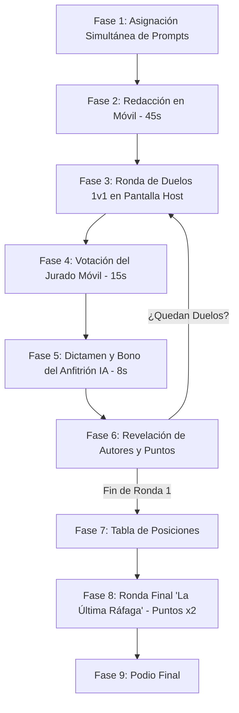
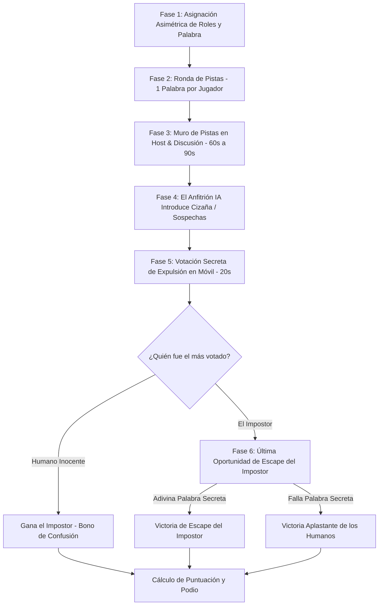
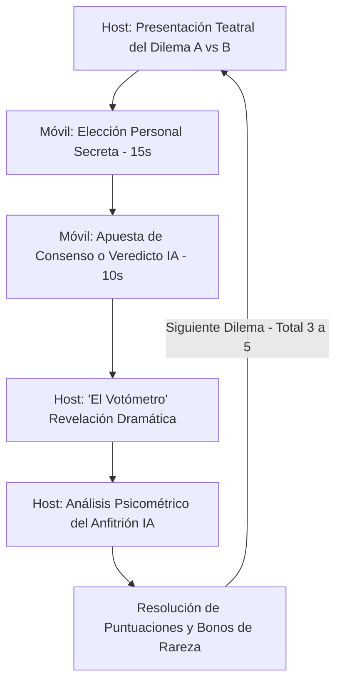
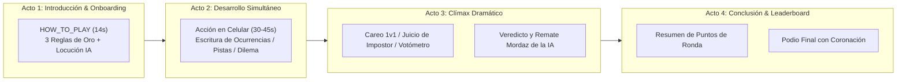

# DOCUMENTO DE DISEÑO DE JUEGO (GAME DESIGN DOCUMENT - GDD)
## Plataforma de Party Games con Información Asimétrica y Anfitrión IA

---

## 1. Visión General y Filosofía Ludológica

### 1.1 Premisa Fundamental
La plataforma transforma cualquier televisor, proyector o pantalla de ordenador en un **Escenario de Fiesta Centralizado (Host Screen)** mientras los smartphones de los jugadores funcionan como **Mandos de Control Asimétricos y Privados (Client Mobile Devices)**. A este ecosistema se integra el **"Anfitrión IA"**, una inteligencia artificial local (vía Ollama) con personalidad carismática, irónica y mordaz que actúa simultáneamente como maestro de ceremonias, juez implacable y generador dinámico de contenido contextual.

### 1.2 Pilares Ludológicos
1. **Cero Fricción de Entrada (Zero-Friction Onboarding):**
   - Sin descargas ni instalaciones de apps. Un código de sala de 4 letras o un código QR en la pantalla del Host conecta al jugador en < 5 segundos vía navegador web moderno.
2. **Asimetría de la Información como Motor de Tensión y Humor:**
   - La pantalla del Host es el teatro público (espectáculo, animación, tensión comunitaria, risas colectivas).
   - El móvil es el confesionario, el bloc de notas secreto y el botón de votación encubierto.
3. **Erradicación Total del Downtime (Tiempos Muertos):**
   - En un Party Game exitoso, la inactividad destruye la energía del salón. Todas las mecánicas deben ejecutarse de forma paralela (simultánea) o convertir a los no-participantes activos en jurado o saboteadores con poder real.
4. **Resurrección Competitiva (Catch-up Mechanics):**
   - El "Efecto Bola de Nieve" o la resignación temprana ("ya perdí en la ronda 1") quedan erradicados mediante multiplicadores exponenciales en rondas finales, bonificaciones por osadía y el "Bono del Desvalido".
5. **Comedia Emergente impulsada por IA:**
   - La IA no reemplaza la creatividad de los jugadores; actúa como catalizador y amplificador humorístico, reaccionando a las ocurrencias humanas con comentarios satíricos y veredictos en tiempo real.

---

## 2. Arquitectura de Información Asimétrica: Matriz de Pantallas

El principio director del juego es la partición estricta de la información visible. La siguiente matriz formaliza qué datos se proyectan en el Host y cuáles se mantienen en el mando privado de cada cliente:

| Canal / Espacio | Pantalla Pública (Host / TV) | Pantalla Privada (Móvil / Smartphone) |
| :--- | :--- | :--- |
| **Identidad & Conexión** | Lista de avatares unidos, código QR de sala, conteo de jugadores listos. | Selector de nombre, avatar/color personal, confirmación de "Listo". |
| **Estado de Ronda** | Temporizador gigante con advertencias de urgencia, número de ronda, fase global. | Temporizador personal sincronizado con vibración táctil háptica en los últimos 5s. |
| **Entrada Creativa (Escritura)** | Indicador de quién sigue redactando ("Esperando respuestas: 4/8"), animaciones de suspense. | Teclado, pregunta específica asignada, campo de texto con límite de caracteres, botón enviar. |
| **Duelo / Debate** | Pregunta en grande, Respuestas A y B anónimas proyectadas con efectos visuales. | Si eres duelista: "¡Es tu duelo! Mantén la cara de póquer". Si eres jurado: Botones A y B para votar. |
| **Deducción Social (Impostor)** | Categoría pública, muro común de pistas enviadas, temporizador de debate. | Tu rol (Humano / Impostor). Para humanos: Palabra Secreta. Para impostor: "Eres el Impostor. ¡Finge!". |
| **Votación de Sospechosos** | Muro de jugadores con contador de "Votos emitidos: X/N" (sin mostrar quién votó a quién). | Cuadrícula con fotos/nombres de todos los jugadores para emitir el voto secreto con 1 toque. |
| **Juicio & Puntuaciones** | Animación de apertura de sobres, lectura del veredicto del Anfitrión IA, podio cinemático. | Notificación de puntos ganados ("+300 pts"), medalla obtenida, desglose individual privado. |
| **Fase Pasiva / Espera** | Animaciones globales y música de fondo. | Pad de reacciones con emojis en vivo (🎉, 😂, 💩, 🔥) que flotan en la pantalla del Host. |

---

## 3. Especificación Detallada de Minijuegos

---

### 3.1 Minijuego 1: "Duelo de Ocurrencias"

#### A. Resumen y Loop Principal
Batalla de ocurrencias por parejas donde dos jugadores responden al mismo prompt cómico sin ver la respuesta del otro. En la pantalla pública se enfrentan ambas respuestas de forma anónima; el resto de los jugadores (el jurado popular) vota su favorita. Para cerrar el duelo, el **Anfitrión IA** emite una crítica demoledora y otorga el "Premio de la Crítica" a una de las opciones.



#### B. Mecánica de Emparejamiento Graficado (Grafo Cíclico)
Para garantizar equilibrio absoluto entre 3 y 12 jugadores sin sesgos de popularidad:
- Cada jugador recibe exactamente **2 prompts** diferentes por ronda.
- Cada prompt es compartido por exactamente **2 jugadores** (Duelistas).
- Se construye un grafo cíclico no dirigido $G = (V, E)$, donde cada nodo es un jugador y cada arista representa un prompt compartido.
- **Fórmula de Prompts Totales por Ronda:**  
  $$N_{\text{prompts}} = N_{\text{jugadores}}$$
  (Ejemplo: 6 jugadores = 6 prompts, 6 duelos; cada jugador aparece en exactamente 2 duelos).

#### C. Fórmulas de Puntuación Matemática
1. **Puntos por Voto Popular ($P_{\text{voto}}$):**
   $$P_{\text{voto}} = V_{\text{recibidos}} \times 500 \times M_{\text{ronda}}$$
   - Donde $M_{\text{ronda}} = 1.0$ en Ronda 1 (500 pts/voto), y $M_{\text{ronda}} = 2.0$ en Ronda Final (1,000 pts/voto).
2. **Bono de Victoria Aplastante / Barredora ($B_{\text{unanimidad}}$):**
   Si un duelista obtiene el 100% de los votos del jurado (mínimo 2 votos):
   $$B_{\text{unanimidad}} = +250 \times M_{\text{ronda}}$$
3. **Bono de la Crítica del Anfitrión IA ($B_{\text{IA}}$):**
   El modelo Ollama evalúa ambas respuestas y otorga a la más ocurrente/absurda:
   $$B_{\text{IA}} = +250 \times M_{\text{ronda}}$$
4. **Bono de Jurado Rápido ($B_{\text{velocidad}}$):**
   Los votantes que emiten su voto válido dentro de los primeros 3 segundos de votación ganan:
   $$B_{\text{velocidad}} = +50 \text{ pts}$$

#### D. La Gran Ronda Final: "La Última Ráfaga" (Catch-Up Mode)
- **Mecánica especial:** Todos los jugadores reciben el **mismo prompt definitivo** simultáneamente.
- **Votación:** En la pantalla se muestran todas las respuestas en mosaico ciego numerado (1 al N).
- Cada jugador tiene **3 medallas de puntos** para repartir en su teléfono (Oro = 300 pts, Plata = 200 pts, Bronce = 100 pts), sin poder votarse a sí mismo.
- Esta inyección masiva de puntos permite remontadas drásticas desde la cola de la tabla.

---

### 3.2 Minijuego 2: "El Impostor de Silicio"

#### A. Resumen y Loop Principal
Juego de deducción social y engaño verbal. Todos los jugadores reciben en secreto una **Categoría** (ej. "Lugares de Vacaciones") y una **Palabra Secreta** (ej. "Playa de Cancún"), EXCEPTO uno (o dos en partidas grandes) que es designado como el **"Impostor de Silicio"**. El Impostor solo conoce la Categoría general.



#### B. Flujo de Fases y Reglas de Pistas
1. **Asignación Secreta:**
   - Humanos ven: `Categoría: Animales Salvajes | Palabra: León`.
   - Impostor ve: `Categoría: Animales Salvajes | ROL: IMPOSTOR. ¡Finge que sabes la palabra!`.
2. **Generación de Pistas (Modo Cadena o Simultáneo):**
   - Cada jugador escribe exactamente **1 sola palabra o frase corta (máx 20 caracteres)** como pista.
   - *Regla ludológica:* Si la pista es demasiado obvia, el Impostor deducirá la palabra secreta. Si la pista es demasiado críptica, el grupo pensará que eres el Impostor y te linchará.
3. **El Muro de Pistas y Debate Abierto:**
   - Todas las pistas aparecen proyectadas en el Host junto a los nombres de los jugadores.
   - El Anfitrión IA lee las pistas y resalta contradicciones cómicas con un comentario incisivo.
4. **Votación de Acusación Secreta:**
   - Cada jugador elige en su teléfono a quién considera el Impostor.
5. **Mecánica de Escape del Impostor (The Hacker Backdoor):**
   - Si el Impostor es descubierto por mayoría de votos, se detiene la música dramática.
   - El Host muestra: *"¡Impostor interceptado! Accediendo a protocolo de anulación..."*
   - El móvil del Impostor despliega 5 palabras alternativas de la misma categoría (la correcta + 4 señuelos generados por IA).
   - Si el Impostor adivina la palabra correcta en 10 segundos, ¡hackea el sistema y roba la victoria!

#### C. Fórmulas de Puntuación y Equilibrio
- **Victoria Total del Impostor (No fue el más votado):**  
  $$P_{\text{impostor}} = +500 \text{ pts}$$
- **Bono de Confusión del Impostor:**  
  $$P_{\text{confusion}} = V_{\text{recibidos por inocentes}} \times 50 \text{ pts}$$
- **Victoria de Escape del Impostor (Descubierto pero adivina la palabra):**  
  $$P_{\text{escape}} = +350 \text{ pts}$$
- **Acierto de Humano Vigilante:**  
  Cada humano que haya votado correctamente al verdadero Impostor:  
  $$P_{\text{humano}} = +200 \text{ pts}$$
- **Pena de Linchamiento Injusto (Chivo Expiatorio):**  
  El humano inocente que reciba la mayor cantidad de votos del grupo pierde $50$ pts (humorístico, evita empates apáticos).
- **Premio IA a la Mejor Pista / Coartada:**  
  El Anfitrión IA otorga $+100$ pts al jugador con la pista más elegante o al impostor con la mejor coartada.

---

### 3.3 Minijuego 3: "Dilemas Extremos"

#### A. Resumen y Loop Principal
Juego de juicio moral, predicción psicológica y consenso social. El Anfitrión IA genera un dilema hilarante, incómodo o filosóficamente absurdo con dos opciones mutuamente excluyentes (Opción A vs Opción B). Los jugadores no solo eligen qué harían ellos, sino que deben **predecir el consenso del grupo** o **la decisión del algoritmo cínico de la IA**.



#### B. Ejemplos de Dilemas Generados por IA
- **Dilema 1:**  
  *Opción A:* Cada vez que estornudes, dices en voz alta el último mensaje de WhatsApp que recibiste.  
  *Opción B:* Cada vez que saludes a alguien, tienes que oler discretamente su cuello durante 3 segundos.
- **Dilema 2:**  
  *Opción A:* Tener WiFi ilimitado y gratis por el resto de tu vida, pero tu velocidad mental baja un 20%.  
  *Opción B:* Ser un 20% más inteligente, pero todos tus dispositivos tardan 45 segundos en cargar cualquier página.

#### C. Mecánica de Predicción y Fórmulas de Puntuación
1. **Acierto por Consenso de Mayoría ($P_{\text{mayoria}}$):**  
   Si acertaste cuál de las dos opciones recibió más del 50% de los votos del salón:  
   $$P_{\text{mayoria}} = +200 \text{ pts} \times M_{\text{ronda}}$$
2. **Acierto del Juicio de la IA ($P_{\text{prediccion\_IA}}$):**  
   Antes de revelar la votación, los jugadores marcan cuál opción creen que elegirá el Anfitrión IA (quien aplica un filtro utilitarista y satírico). Si aciertan:  
   $$P_{\text{prediccion\_IA}} = +150 \text{ pts} \times M_{\text{ronda}}$$
3. **El Bono "Oveja Negra" / Lobo Solitario ($B_{\text{lobo}}$):**  
   Si exactamente **un único jugador** en toda la sala vota por una de las opciones, ese jugador es coronado como "El Raro de la Fiesta":  
   $$B_{\text{lobo}} = +350 \text{ pts}$$
   *(Estimula a no votar siempre por lo seguro o políticamente correcto).*
4. **El "Dilema Dorado" (División Perfecta 50/50):**  
   Si el grupo queda en un empate matemático exacto (ej. 4 vs 4 en sala de 8):  
   ¡Se declara fallo de la matrix! Todos los jugadores reciben $+250$ puntos de bonificación.

---

## 4. Estrategias de Ludología para Eliminar el Downtime

El mayor destructor de la diversión en juegos de fiesta digitales son los jugadores mirando una pantalla esperando que los demás terminen. Aplicamos un diseño estricto anti-downtime:

### 4.1 Principio de Acciones Simultáneas (Parallel Play)
- **Escritura y Votación Simultánea:** En "Duelo de Ocurrencias", todos los jugadores redactan sus dos prompts al mismo tiempo durante una única cuenta regresiva de 45 segundos. Nadie espera turno de escritura.
- **En los Duelos Ajenos:** Cuando se proyecta un duelo en pantalla Host, los 2 autores son protagonistas de la tensión, y los demás $N-2$ jugadores son **jurados activos** que deben presionar su botón en menos de 15 segundos. Nadie es mero espectador.

### 4.2 Fast-Forwarding Inteligente (Colapso de Temporizador)
Cuando el servidor de sockets detecta que el $100\%$ de los jugadores requeridos para una acción ha enviado su payload (voto o respuesta), el temporizador restante se cancela y se sustituye por una cuenta regresiva relámpago de gracia de **1.5 segundos** (para amortiguar animaciones de clientes).  
*Resultado:* Un grupo rápido nunca sufrirá los 45 segundos completos si terminan en 18s.

### 4.3 Mando Interactivo en Tiempos de Presentación (Reactions & Soundboard)
Durante las fases narrativas o de lectura del Anfitrión IA en la pantalla grande, el móvil de los jugadores no queda congelado. Muestra un **"Mando de Troleo y Ovación"**:
- Botones de emojis en vivo (🔥, 👏, 💀, 🍅, 🤡).
- Al pulsar un emoji en el móvil, este sale disparado desde la parte inferior de la pantalla del Host con física de partículas y sonido de baja latencia.

---

## 5. Temporizadores Dinámicos y Matriz de Escalado (3 a 12 Jugadores)

El número de jugadores altera radicalmente el ritmo del juego. Una partida de 3 jugadores con temporizadores fijos se vuelve aburrida, mientras que una de 12 puede volverse interminable si no se modulan los tiempos de lectura y votación.

### 5.1 Matriz de Configuración por Tamaño de Grupo

| N° Jugadores | Prompts por Jugador | Duelos Totales | Tiempo Escritura (s) | Tiempo Voto Duelo (s) | Tiempo Debate Impostor (s) | Impostores |
| :--- | :--- | :--- | :--- | :--- | :--- | :--- |
| **3 jugadores** | 2 | 3 | 40s | 12s | 45s | 1 |
| **4 a 5 jugadores** | 2 | 4 - 5 | 45s | 14s | 60s | 1 |
| **6 a 7 jugadores** | 2 | 6 - 7 | 50s | 15s | 75s | 1 |
| **8 a 9 jugadores** | 2 | 8 - 9 | 50s | 16s | 90s | 2 *(Opcional)* |
| **10 a 12 jugadores** | 1 (para agilidad) | 5 - 6 | 45s | 18s | 100s | 2 |

### 5.2 Algoritmo de Temporización Dinámica Adaptativa
El tiempo de cada fase se computa en el backend siguiendo la fórmula:
$$T_{\text{fase}}(N) = \text{clamp}\left(T_{\text{base}} + \Delta_{\text{jugador}} \times (N - N_{\text{min}}), \ T_{\text{min}}, \ T_{\text{max}}\right)$$

---

## 6. Mecánicas de Remontada (Catch-Up Mechanics)

La psicología del jugador dicta que si a mitad de partida la distancia con el primer lugar parece insalvable, el jugador pierde el interés competitivo o empieza a sabotear la partida. Implementamos tres capas de salvaguarda:

### 6.1 Multiplicadores Exponenciales de Ronda Final
- **Ronda 1:** Puntuación estándar ($1.0\times$).
- **Ronda 2 / Semifinal:** Puntuación amplificada ($1.5\times$).
- **Ronda Final:** Puntuación colosal ($2.0\times$ o $3.0\times$).
- *Efecto Ludológico:* El 60% de los puntos totales de la partida se disputan en el tercio final. Matemáticamente, cualquier jugador en último lugar puede coronarse si tiene una ronda final memorable.

### 6.2 El "Bono del Desvalido" (Underdog Advantage)
- Al iniciar la Ronda Final, el sistema evalúa la tabla de posiciones acumulada.
- A los jugadores clasificados en el tercio inferior de la tabla se les concede una ventaja táctica oculta en su móvil:
  - En *Duelo de Ocurrencias*: Su respuesta cuenta con un **"Voto de Gracia Extra" (+1)** en caso de empate.
  - En *El Impostor de Silicio*: Si descubren al impostor, reciben un **Multiplicador de Remontada del $1.5\times$** en sus puntos de acierto.
  - En *Dilemas Extremos*: Si aciertan una opción minoritaria o de riesgo, se les duplica la ganancia.

### 6.3 Voto Ciego y Revelación en Orden Inverso
- La puntuación nunca se muestra completa antes de la última revelación.
- Los resultados de la última ronda se revelan en el Host **desde el último lugar hacia el primer lugar** con redoble de tambores y efectos de suspense, manteniendo la incógnita del ganador hasta el último segundo.

---

## 7. Especificación Técnica de Integración con el Anfitrión IA

### 7.1 Formato de Prompting y Respuestas Estructuradas
El Anfitrión IA interactúa mediante llamadas asíncronas con timeout estricto de **3.5 segundos** (fallback automático a comentarios predefinidos si Ollama demora).

#### Esquema de Salida JSON Esperado del Juez IA:
```json
{
  "winner": "A",
  "aiComment": "La respuesta A captura perfectamente el terror existencial de un lunes por la mañana.",
  "criticBonus": true,
  "humorRating": 9,
  "punchline": "Si la respuesta B fuera un plato de comida, sería sopa fría de lechuga."
}
```

### 7.2 Personalidades Seleccionables del Host IA
1. **Sarcástico / Cínico (Por defecto):** Humor negro ligero, no perdona respuestas sosas ni clichés.
2. **Animador Entusiasta:** Celebratorio, enérgico, exagera la genialidad de cualquier chiste.
3. **Crítico Filosófico:** Trata respuestas ridículas con una gravedad cómica desmesurada.

---

## 8. Glosario de Estados y Eventos Socket.io

Para mantener coherencia entre el cliente web (Host y Móvil) y el motor de reglas en Node.js, los siguientes estados y eventos quedan estandarizados:

- `ROOM_STATE_CHANGE`: Emisión con el snapshot completo del estado público y privado filtrado.
- `PHASE_TIMER_TICK`: Sincronización del segundo actual para prevenir desfases visuales.
- `SUBMIT_ANSWER`: Payload `{ roomId, playerId, promptId, text }`.
- `SUBMIT_VOTE`: Payload `{ roomId, playerId, duelId, chosenOption }`.
- `SUBMIT_CLUE`: Payload `{ roomId, playerId, clueWord }`.
- `SUBMIT_DILEMMA_CHOICE`: Payload `{ roomId, playerId, dilemmaId, choice, prediction }`.
- `FAST_FORWARD_TRIGGERED`: Anuncio del servidor de que todos votaron y se acelera el timer.
- `AI_HOST_COMMENTARY`: Emisión de audio TTS o texto con animación de locución del presentador.

---

## 9. Sistema Formal de Tutorialización ("HOW_TO_PLAY") y Micro-Instrucciones Contextuales Móviles (CTA)

### 9.1 Diagnóstico Ludológico: El Abismo de Entrada en los Party Games
Un party game sin onboarding interactivo genera dos fricciones letales:
1. **Confusión en la Mesa ("¿De qué va esto?"):** Si los jugadores no entienden el objetivo ni las reglas antes de que el reloj empiece a correr, su primera respuesta será deficiente o apática.
2. **Ceguera de Mando ("¿Qué toco en mi teléfono?"):** Cuando la pantalla del móvil no indica claramente el rol, el estado actual y la acción requerida, el jugador aparta la mirada o presiona botones al azar.

Para erradicar esto, todo minijuego arranca obligatoriamente con una fase formal de **Tutorialización (`HOW_TO_PLAY`) de 12 a 15 segundos** proyectada en la pantalla del Host con locución por voz del Anfitrión IA, mientras el móvil muestra una tarjeta de preparación previa.

---

### 9.2 Las 3 Reglas de Oro, Objetivo, Mando y Economía por Minijuego

#### A. Minijuego 1: "Duelo de Ocurrencias"
* **Objetivo del Juego:** Escribir las ocurrencias más graciosas, absurdas o mordaces para derrotar a tus amigos en duelos 1v1 anónimos, conquistando los votos del jurado popular y el visto bueno del Anfitrión IA.
* **Las 3 Reglas de Oro (Host TV):**
  1. ✍️ **Sé Rápido y Divertido:** Recibirás 2 preguntas en tu celular. Responde antes de que expire el tiempo; ¡cualquier disparate es mejor que dejarlo en blanco!
  2. 🗳️ **El Salón es el Jurado:** En cada duelo se enfrentan 2 respuestas anónimas en la TV. Si tú no estás en el duelo, ¡vota en tu móvil por la que te haga reír más!
  3. 🤖 **Teme (o Ama) a la IA:** El Anfitrión IA destrozará las respuestas sosas con comentarios demoledores y otorgará un bono especial a su favorita.
* **Interacción en tu Celular:**
  - *Fase Escritura:* Teclado con campo de texto para tus 2 respuestas asignadas.
  - *Fase Duelo:* Dos botones gigantes (Opción A vs Opción B). Si es tu duelo: mensaje de suspense "Mantén cara de póquer".
  - *Fase Resultados:* Pad de reacciones con emojis en vivo (🔥, 😂, 💩) para ovacionar o trolear en la TV.
* **Economía de Puntos:**
  - **Voto del Jurado:** +500 pts (+1,000 pts en Ronda 2).
  - **Victoria Aplastante ("Barredora"):** +250 pts si logras el 100% de los votos del salón.
  - **Bono de la Crítica IA:** +250 pts al favorito del algoritmo.
  - **Voto Relámpago:** +50 pts si votas en menos de 3 segundos.
* **Guion de Voz del Anfitrión IA:**
  *"¡Bienvenidos al Duelo de Ocurrencias! Recibirán dos preguntas en su celular. Sean rápidos e ingeniosos. Luego, las respuestas se enfrentarán cara a cara en esta pantalla y todo el salón votará por la mejor. ¡Y prepárense, porque yo también juzgaré sus ocurrencias!"*

---

#### B. Minijuego 2: "El Impostor de Silicio"
* **Objetivo del Juego:**
  - *Si eres Humano / Inocente:* Identificar al impostor que no conoce la palabra secreta sin regalarle la palabra en tus pistas.
  - *Si eres el Impostor de Silicio:* Fingir que conoces la palabra secreta, desviar las sospechas hacia inocentes y, si te descubren, ¡hackear la palabra en el último segundo para escapar!
* **Las 3 Reglas de Oro (Host TV):**
  1. 🤫 **Mira tu Móvil en Secreto:** Todos reciben la Categoría y la Palabra Secreta, EXCEPTO el Impostor, que solo conoce la Categoría. ¡No dejes que espíen tu pantalla!
  2. 🧩 **Da una Pista de Una Sola Palabra:** Escribe 1 pista sutil. Si es demasiado obvia, el Impostor sabrá la palabra. Si es muy rara, te lincharán a ti.
  3. 🚨 **Juicio, Votación y Fuga:** Debatan en voz alta y voten al sospechoso. Si atrapan al Impostor, ¡él tendrá una última oportunidad de adivinar la palabra y robar la victoria!
* **Interacción en tu Celular:**
  - *Fase Revelación:* Tarjeta confidencial con tu rol y palabra clave.
  - *Fase Pistas:* Formulario de 1 sola palabra (máximo 25 caracteres).
  - *Fase Votación:* Galería de sospechosos con sus avatares y pistas para votar con 1 toque.
  - *Fase Fuga:* 4 botones de selección múltiple (1 palabra real + 3 señuelos) solo para el Impostor atrapado.
* **Economía de Puntos:**
  - **Victoria del Impostor:** +500 pts si pasa desapercibido sin ser el más votado.
  - **Bono de Confusión:** +50 pts por cada voto que reciba un inocente.
  - **Fuga Cibernética:** +350 pts si el Impostor atrapado adivina la palabra secreta en su móvil.
  - **Acierto Humano:** +200 pts a cada inocente que vote correctamente al verdadero Impostor.
  - **Chivo Expiatorio:** -50 pts (penalización cómica) al inocente más votado por el grupo.
* **Guion de Voz del Anfitrión IA:**
  *"¡Comienza El Impostor de Silicio! Todos menos uno conocen la palabra secreta. Escriban una pista sutil en sus teléfonos, debatan en voz alta y voten por el sospechoso. ¡Pero cuidado! Si el impostor adivina la palabra secreta al final, se robará toda la gloria."*

---

#### C. Minijuego 3: "Dilemas Extremos"
* **Objetivo del Juego:** Enfrentar dilemas morales y absurdos, elegir tu postura sincera y predecir la mente colmena del salón o el oscuro criterio del Anfitrión IA para acumular la mayor cantidad de puntos.
* **Las 3 Reglas de Oro (Host TV):**
  1. ⚖️ **No Hay Opción Cómoda:** La TV mostrará un dilema ridículo o incómodo entre la Opción A y la Opción B. ¡No puedes abstenerte!
  2. 🔮 **Voto Doble en tu Móvil:** Primero votas qué harías tú en secreto. Luego apuestas qué crees que votará la MAYORÍA de tus amigos.
  3. 🐺 **Premios a la Rareza y al Caos:** Si eres el único que vota por una opción ganas el Bono Lobo Solitario. Y si el salón empata 50/50, ¡todos ganan bono de crisis existencial!
* **Interacción en tu Celular:**
  - *Paso 1:* Botones gigantes A y B para tu elección personal.
  - *Paso 2:* Selector de predicción de la mayoría.
  - *Fase Votómetro:* Animación de barras sincronizadas con la pantalla principal.
* **Economía de Puntos:**
  - **Acierto de Mayoría:** +200 pts (+400 pts en Ronda Final).
  - **Acierto de Veredicto IA:** +150 pts.
  - **Bono Lobo Solitario:** +350 pts si eres el ÚNICO voto en toda la sala por esa opción.
  - **Dilema Dorado (50/50):** +250 pts a todos si el grupo empata exactamente a la mitad.
* **Guion de Voz del Anfitrión IA:**
  *"¡Llegó la hora de Dilemas Extremos! Les presentaré situaciones morales absurdas e incómodas. En sus celulares, elijan qué harían y apuesten qué votará la mayoría del salón. ¡Veamos qué tan retorcidos son sus amigos!"*

---

### 9.3 Especificación del Módulo Móvil de Micro-Instrucciones Contextuales (CTA)
En cada pantalla del móvil, la parte superior fija debe contener un banner visual (`cta-banner`) de alta visibilidad compuesto por:
1. `headline`: Título en negrita y mayúsculas con emoji indicando el modo (ej: `✍️ ESCRIBE TUS OCURRENCIAS`, `🗳️ ¡ERES JURADO! VOTA AHORA`).
2. `instruction`: La orden concreta de acción en lenguaje directo (ej: `Elige en tu celular la respuesta que te haga reír más.`).
3. `badge`: Píldora de estado en color neón (`⏳ ACCIÓN REQUERIDA`, `👀 MIRA LA PANTALLA`, `🤫 MANTÉN CARA DE PÓQUER`, `🚨 MODO INFILTRADO`).
4. `subtext`: Pista de contexto o refuerzo cómico para tranquilizar al jugador.

---

## 10. Estructuración del Bucle de Juego (Game Loop Arc) en 4 Actos

Para evitar que los juegos se sientan fragmentados o inconclusos, cada partida adopta la estructura dramática clásica de cuatro actos:



1. **Acto 1 (Introducción & Onboarding):**
   - La pantalla grande abre el telón con `HOW_TO_PLAY`.
   - Se explican las 3 Reglas de Oro y la economía de puntos mientras la voz de la IA lee las instrucciones.
   - En el celular se muestra un mensaje de "Presta atención a la TV".
2. **Acto 2 (Desarrollo Paralelo y Creativo):**
   - Los jugadores interactúan de forma simultánea (sin esperas por turnos).
   - El temporizador dinámico se reduce automáticamente mediante Fast-Forwarding si todos completan la tarea antes del tiempo límite.
3. **Acto 3 (Clímax Dramático y Veredicto):**
   - *En Duelo:* Animación de VS con choque de avatares antes de abrir la votación, seguido del remate y bono de la IA.
   - *En Impostor:* Muro de pistas, debate con cizaña del Anfitrión IA, votación secreta de linchamiento y, si es atrapado, la ventana de 12 segundos de Fuga Cibernética.
   - *En Dilemas:* Presentación teatral, votación a dos pasos, animación de llenado del Votómetro y diagnóstico psiquiátrico burlón de la IA.
4. **Acto 4 (Conclusión y Puntuación):**
   - Tabla de posiciones de la ronda con animaciones de subida y badges de bonificación otorgados.
   - Si es la Ronda Final, se activan los multiplicadores de remontada ($2.0\times$) y la revelación dramática del podio del 3er al 1er lugar.

---

## 11. Especificación de Datos y Estados para Backend y Frontend

### 11.1 Payloads Emitidos en `room:state_update` (Host Screen)
```typescript
interface PublicGameState {
  gameId: 'duelo-ocurrencias' | 'impostor-silicio' | 'dilemas-extremos';
  gameTitle: string;
  phase: 'HOW_TO_PLAY' | 'INTRO' | 'ANSWERING' | 'CLUES' | 'DEBATE' | 'CHOICE' | 'VOTING' | 'ESCAPE' | 'REVEAL' | 'AI_JUDGING' | 'ROUND_RESULTS' | 'RESULTS' | 'PODIUM';
  currentRound: number;
  totalRounds: number;
  timer: number;
  howToPlay: {
    title: string;
    tagline: string;
    objective: string;
    goldenRules: Array<{ number: number; title: string; description: string; icon: string }>;
    mobileGuide: Array<{ step: number; title: string; description: string; icon: string }>;
    scoringEconomy: Array<{ event: string; points: string; description: string; icon: string }>;
    hostNarration: string;
  };
  cta: {
    headline: string;
    instruction: string;
    badge: string;
    subtext: string;
  };
  leaderboard: Array<{ id: string; name: string; avatar: string; score: number; roundDelta: number }>;
  podium?: Array<{ id: string; name: string; avatar: string; score: number }>;
}
```

### 11.2 Payloads Emitidos en `player:private_state` (Móvil)
```typescript
interface PrivatePlayerState {
  gameId: string;
  phase: string;
  currentRound: number;
  totalRounds: number;
  timer: number;
  cta: {
    headline: string;
    instruction: string;
    badge: string;
    subtext: string;
  };
  // Propiedades contextuales por juego:
  // Duelo: prompts, allSubmitted, isDuelist, hasVoted, options
  // Impostor: category, isImpostor, secretWord (null si es impostor), candidates, escapeOptions
  // Dilemas: dilemma, hasChosen, myChoice, myPrediction
}
```

---

*Fin del Documento de Diseño de Juego (GDD).*
