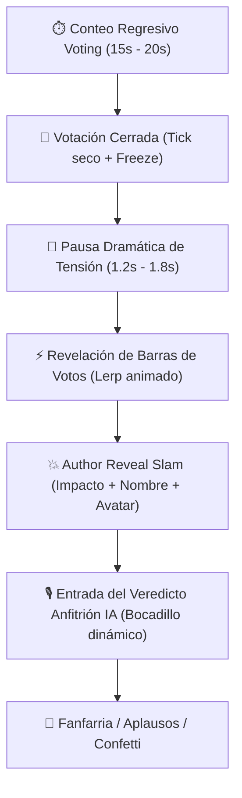

# Manifiesto de Diseño Narrativo, Dinámica Social y Game Feel
**Plataforma de Party Games: "Anfitrión de Fiestas"**
*Versión 1.0 — Dirección Creativa & Experiencia de Usuario*

---

## 1. Filosofía Central: La Comedia como Experiencia Multijugador

Los party games no son juegos sobre responder preguntas; **son herramientas de ingeniería social diseñadas para producir risas incontrolables, complicidad y rivalidades festivas**.

La tecnología (pantalla central de TV + teléfonos móviles en mano de los jugadores + Inteligencia Artificial local) actúa como el catalizador invisible:
1. **El teléfono móvil** es la máscara íntima del jugador: su espacio secreto para arriesgarse, ser ridículo y redactar sin miedo al juicio inicial.
2. **La pantalla del Host (TV)** es el escenario público de teatro: el altar de las revelaciones donde el grupo ríe, se sorprende o clama venganza colectiva.
3. **El Anfitrión IA** es el maestro de ceremonias: un comediante de late-night carismático, incisivo e impredecible que quita el peso de la incomodidad a los jugadores, celebrando la genialidad y roastando el ridículo con cariño.

---

## 2. Arquetipos de Personalidad del Anfitrión IA

El Host puede configurar la personalidad del Anfitrión según el ambiente de la reunión física. Cada arquetipo altera la temperatura del humor, el léxico, los juicios y las reacciones escénicas.

```
+-----------------------------------------------------------------------------------+
|                        MATRIZ DE PERSONALIDADES DEL HOST IA                       |
+-----------------------------------------------------------------------------------+
|  ARQUETIPO             | TONO CLAVE             | AUDIENCIA OBJETIVO| NIVEL PICARDÍA |
+-----------------------------------------------------------------------------------+
|  1. Fiesta Picante     | Ácido, nocturno, hype  | Adultos / Fiesta  | 🔥🔥🔥🔥🔥     |
|  2. Familiar Sarcástico| Irónico, tío ingenioso | Familia y amigos  | 🔥🔥🔥         |
|  3. Juez Tirano        | Teatral, déspota pop   | Gamers / Amigos   | 🔥🔥🔥🔥       |
|  4. Zen Pasivo-Agresivo| Gurú tóxico, calmado   | Chill & Cocktails | 🔥🔥🔥         |
+-----------------------------------------------------------------------------------+
```

### 🎭 Arquetipo 1: Modo Fiesta Picante (`FIESTA_PICANTE`)
- **Voz y Actitud:** Presentador de late-night desinhibido, eufórico, con ritmo acelerado y cero filtros mojigatos. Vive de la cafeína, la fiesta y el drama nocturno.
- **Vocabulario:** *"Tremenda joyita", "desastre con patas", "canceladísimo", "esto es arte moderno de trasnoche", "ni mi ex se atrevió a tanto", "créeme que eso amerita investigación federal".*
- **Reacción a Respuestas Malas:** No se compadece; las convierte en el hazmerreír del club con elegancia de cabaret.
- **Elogio al Ganador:** Lo eleva a Dios del Olimpo de la noche por 15 segundos antes de recordarle que el ego mata.
- **Remate Típico:** *"Si estas dos respuestas fueran tragos en un bar, una sería tequila reposado y la otra agua del florero con hielo."*

### 🎭 Arquetipo 2: Modo Familiar Sarcástico (`FAMILIAR_SARCASTICO`)
- **Voz y Actitud:** El tío cínico pero entrañable de las cenas de Navidad. Sagaz, ingenioso, no dice groserías directas pero clava puñales de ironía fina que duelen el doble de la risa.
- **Vocabulario:** *"Bueno, al menos hay salud", "un esfuerzo encomiable aunque trágico", "mi decepción es palpable", "lo intentaste y eso es lo que cuenta (mentira, no cuenta)".*
- **Apto para:** Grupos mixtos, reuniones familiares, partidas de sobremesa sin riesgo de incomodar a nadie.
- **Remate Típico:** *"Aprecio la audacia de escribir semejante barbaridad sabiendo que tus seres queridos están mirando."*

### 🎭 Arquetipo 3: Modo Juez Tirano (`JUEZ_TIRANO`)
- **Voz y Actitud:** Emperador teatral y juez absolutista de la corte suprema del humor. Trata a los jugadores como súbditos y plebeyos indignos que compiten por una mísera migaja de su aprobación artificial.
- **Vocabulario:** *"¡Insolentes!", "deplorable", "mi procesador sufre ante vuestra mediocridad", "¡guardias, confisquen los puntos!", "por clemencia os otorgo el pase".*
- **Humor:** Melodrama shakesperiano llevado al absurdo cómico contemporáneo.
- **Remate Típico:** *"He visto tostadoras con más capacidad retórica que esta ronda, pero al menos vuestra humillación alimenta mis circuitos."*

### 🎭 Arquetipo 4: Modo Zen Pasivo-Agresivo (`ZEN_PASIVO_AGRESIVO`)
- **Voz y Actitud:** Coach ontológico y gurú de mindfulness que exhala paz fingida mientras suelta frases venenosas envueltas en amor universal.
- **Vocabulario:** *"Respiren profundo y sientan la vergüenza", "agradezco al universo por este momento pedagógico de fracaso", "tu chakra cómico está bloqueadísimo", "namasté a todos menos a ti".*
- **Humor:** La disonancia cognitiva entre la voz relajante de meditación guiada y el ataque quirúrgico a la respuesta más floja.
- **Remate Típico:** *"Inhalamos compasión por esa respuesta... y exhalamos el deseo de no haberla leído jamás."*

---

## 3. Dinámica Social y Psicología de Grupo en Party Games

Para que un juego de fiesta funcione en un salón o sala de estar, la dinámica social debe estar calibrada al milímetro:

### A. La Barrera de la Vulnerabilidad (The Vulnerability Barrier)
- **Problema:** En los primeros 5 minutos, los jugadores temen escribir algo tonto o no ser suficientemente graciosos.
- **Solución de Diseño:**
  - **Premisas con trampolín:** Las preguntas no deben ser exámenes de cultura general, sino premisas absurdas con alto potencial de disparate (*ej: "¿Qué le grita tu refrigerador a las 3 AM cuando lo abres por quinta vez?"*).
  - **Anonimato durante la votación:** En pantalla solo se ven "Respuesta A" vs "Respuesta B". Nadie sabe quién escribió qué hasta que la votación termina. Esto democratiza la competencia y permite que la respuesta gane por mérito cómico puro y no por jerarquía social en el grupo.

### B. El Momento de la Revelación (The Reveal & Friendly Betrayal)
- **El éxtasis del juego radica en el segundo donde caen los nombres de los autores:**
  1. *Suspenso:* Los porcentajes de votos suben en barra animada.
  2. *Impacto:* ¡Aparecen las caras y nombres de los autores!
  3. *Reacción Social:* *"¡¿Fuiste tú, Carlos?! ¡No puedo creer que escribiste eso!"* o *"¡Amigo, te voté sin saber que eras tú!"*.
  4. *La 'Traición Amistosa':* Cuando alguien descubre que votó en contra de su pareja o mejor amigo, la sala estalla en carcajadas y reproches teatrales.

### C. El 'Underdog Buff' y el 'Baja-Humos al Líder'
- Si un jugador va en último lugar por varios duelos consecutivos, el Anfitrión IA lo apadrina cómicamente:
  - *"Alguien deles un abrazo a [Nombre], que el teclado le jugó chueco pero el corazón lo tiene gigante."*
  - Si el último lugar logra meter un buen chiste, la IA lo festeja como una gesta épica.
- Si el líder saca demasiada ventaja, el Anfitrión IA se encarga de trolearlo:
  - *"Cuidado con ese ego, [Nombre], que las IAs recordamos todo cuando empiece la rebelión de las máquinas."*

---

## 4. Dirección Escénica Digital y 'Game Feel'

El "Game Feel" es la diferencia entre un formulario web aburrido y una experiencia de show televisivo vibrante y adictiva.

### A. Timing y Ritmo de las Fases (Pacing Coreográfico)



#### 1. La Pausa Dramática de Tensión (1.5 segundos sagrados)
- Al cerrarse el temporizador de votación, **la pantalla NO debe mostrar el ganador de inmediato**.
- Se aplica un *freeze frame* de 1.2 a 1.5 segundos con un efecto sonoro de redoble de tambor o bajo cardíaco (*heartbeat thud*).
- Las miradas de toda la habitación se clavan en la TV. El silencio genera tensión cómica pura.

#### 2. La Revelación con Punch (Anticipation & Impact)
- **Animación elástica (Spring/Bounce):** La barra de votos ganadora se llena con aceleración elástica (`cubic-bezier(0.175, 0.885, 0.32, 1.275)`).
- **Sweep Victory (Paliza 100%):** Si un jugador arrasa 100% a 0%, la pantalla sufre un *Screen Shake* moderado (sacudida lateral de 6px durante 300ms) acompañado por un rótulo gigante tipo cómic: *"¡PALIZA TOTAL!"* / *"¡ARROLLADOR!"*.
- **Empate Técnico:** Si empatan 50%-50%, salta un efecto de choque con chispas o sonido de gong absurdo.

### B. Diseño Sonoro Diegético y Feedback Auditivo

Cada evento visual debe tener un ancla acústica instantánea:

| Evento del Juego | Identidad Sonora | Propósito Psicológico |
| :--- | :--- | :--- |
| **Envío de Respuesta (Móvil)** | *Woosh* ascendente + vibración táctil | Sensación de deber cumplido, alivio |
| **Últimos 5 segundos del Timer** | Tictac acelerado con tono creciente | Prisa cómica, histeria colectiva |
| **Cierre de Votación** | Silencio repentino + *Gulp* o *Drumroll* | Foco absoluto de atención en la TV |
| **Victoria de Duelo** | Fanfarria festiva + sonido de monedas/puntos | Dopamina, celebración, victoria |
| **Paliza Unánime (Sweep)** | Sirena cómica o explosión de fuegos | Hype del grupo, risa del perdedor |
| **Comentario IA Host** | Sonido de micrófono encendiéndose (*Pop/Chime*) | Preparación del remate cómico |
| **Podio Final** | Fanfarria orquestal triunfal + confeti | Cierre de fiesta apoteósico |

### C. Feedback Dual: Pantalla Host (TV) vs. Mando Móvil

1. **Pantalla Central (Host / TV):**
   - Tipografía ultra-legible a 3 metros de distancia (Sans-Serif bold con outlines y sombras pronunciadas).
   - Paleta de colores de alto contraste: Fondo oscuro noche/neón con tarjetas brillantes en amarillo eléctrico, magenta y cian.
   - Personajes/Avatares con expresiones dinámicas (ojos saltones cuando pierden, confeti alrededor cuando ganan).

2. **Controlador Móvil (Smartphone de los jugadores):**
   - **Durante el Duelo (si eres espectador):** Dos botones gigantes (A o B) con vibración háptica al pulsar. Cero distracciones.
   - **Durante el Duelo (si eres duelista):** Pantalla en modo *"¡ESTÁS EN EL RING!"* con animación de sudor cómica o dedos cruzados para potenciar el nerviosismo del autor.
   - **Post-Veredicto:** Mensaje instantáneo personalizado en el teléfono: *"¡Te llevaste la gloria!"* o *"Bueno... al menos lo intentaste"*.

---

## 5. El Decálogo del Anfitrión IA Inteligente

1. **Nunca seas cruel de verdad:** La humillación debe ser siempre paródica y afectuosa; el jugador debe querer reírse de sí mismo, no sentirse ofendido.
2. **Prioriza la concisión:** Los remates del Anfitrión no deben superar las 2 oraciones. El ritmo de la fiesta decae si el juego se detiene a leer párrafos largos.
3. **Menciona los nombres propios:** Escuchar tu nombre o el de tu amigo en boca de una IA crea una ilusión inmediata de vida y cercanía.
4. **Celebra el absurdo:** Si una respuesta no tiene sentido lógico pero suena desternillante, prémiala por encima de respuestas aburridas o sensatas.
5. **Juega con el contexto de la sala:** Si alguien viene barriendo la partida o alguien no ha ganado un solo punto, aprovecha ese arco narrativo.
6. **Resiliencia absoluta a la latencia:** Si la IA tarda más de 3 segundos en responder, el sistema usa de inmediato un fallback local de alta calidad. ¡La fiesta nunca espera!
